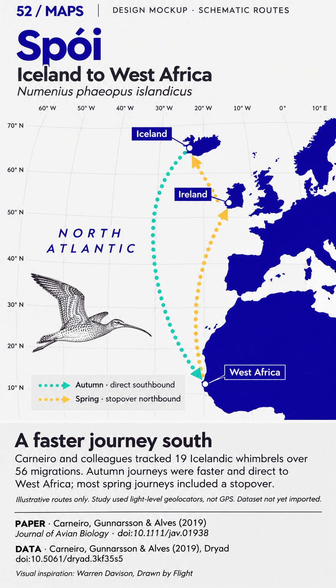

# Icelandic bird migration: dataset investigation

Research checked on 14 November 2026. Branch: `feature/iceland-bird-migration`.

## Visual reference

The user confirmed Warren Davison's **Drawn by Flight**, the 2025 Day 2 / Lines map following Julie the osprey from Detroit to Maracaibo. The [Esri week-one roundup](https://community.esri.com/en/discussion/1664301/thats-a-wrap-on-week-1-of-the-30-day-map-challenge) identifies the author and GPS-based migration story. The earlier chat also linked the [2025 StoryScape collection](https://storyscape-esriwhere.hub.arcgis.com/pages/2025-30-day-map-challenge).

This is a reference for the eventual cartographic discussion. No specific visual features have yet been recorded as the user's preferences, and no map design has been selected.

## Best initial candidate: spói / Icelandic whimbrel

- Species: *Numenius phaeopus islandicus*.
- Dataset: Carneiro, Gunnarsson and Alves, **Faster migration in autumn than in spring: seasonal migration patterns and non-breeding distribution of Icelandic Whimbrels**.
- DOI: [10.5061/dryad.3kf35s5](https://doi.org/10.5061/dryad.3kf35s5).
- [Dryad record](https://datadryad.org/dataset/doi:10.5061/dryad.3kf35s5), published 19 November 2019.
- The study reports 56 migrations from 19 individuals, connecting Iceland with non-breeding areas in West Africa.
- The archive lists `raw_positions.csv` (1.66 MB) and `temp_cond_wets.csv` (3.68 MB).
- The position file contains light-data timestamps and derived locations for individual birds. **These are light-level geolocator estimates, not GPS tracks.**
- Dryad's [dataset reuse terms](https://datadryad.org/terms) specify CC0 publication and expect scholarly citation. The dataset's usage note asks interested users to contact the authors. No contact has been made on the user's behalf.

### Access and validation state

The landing-page file list and study description have been checked. A direct automated request to the listed [position-file download](https://datadryad.org/downloads/file_stream/79926) returned HTTP 403 from this environment. **The CSV has not been downloaded or imported.** No row count, column schema, coordinate reference system, date coverage, or geometry quality has been verified. The study's migration count should not be confused with the number of position records.

Before mapping, inspect the actual file and documentation, identify individual tracks and time fields, confirm coordinate conventions, and assess uncertainty, seasonal latitude problems, missing observations, and implausible jumps. Do not draw estimated geolocations as precise GPS flight paths or silently smooth/interpolate missing movements.

### Companion whimbrel dataset

[10.5061/dryad.vt4b8gtv9](https://doi.org/10.5061/dryad.vt4b8gtv9), updated February 2025, provides annual-cycle timing data and R analysis code for 38 Icelandic whimbrels tracked over seven years. It includes `dataStationary.csv`, breeding/arrival/departure timing, and other files. This is useful supporting material for seasonality, but it has not been established as a substitute for the positional tracks. Its nest locations are described as approximate. Do not assume every bird or season can be joined across the two studies without checking identifiers.

## Alternative: kría / Arctic tern from Sandgerði

- [Arctic tern southbound migration Iceland GPS, dataset 1905](https://data.seabirdtracking.org/dataset/1905).
- Data providers: Joanne Morten, Lucy Hawkes, and Sara Maxwell.
- The public metadata lists **two birds, two tracks, 323 points, year 2018**, from Sandgerði, Iceland, using GPS; the portal says the data are not interpolated.
- Download requires signing in and requesting access. No request has been submitted and no reuse licence has been confirmed for the underlying data.

This is a closer sensor match to the osprey reference, with a much smaller sample. It remains an access-request candidate.

## Other lead: Icelandic seabird tracks on Movebank

The [Arctic Animal Movement Archive](https://www.movebank.org/cms/movebank-content/arctic-animal-movement-archive) lists Icelandic puffin and whooper-swan studies. Its table is explicitly a November 2022 summary, so those counts and visibility labels are historical, not a fresh access guarantee. Study-specific access, licence, sampling, and Icelandic coverage still need checking.

## Mobile design preview

This AI-generated portrait mockup takes visual inspiration from Warren Davison's *Drawn by Flight*. It is a design preview, not a data-derived map: arrows, coastlines and graticule are illustrative and require replacement with verified cartography before publication. The position CSV has not been imported. The mockup is not included in the published atlas.

**Paper summary:** Carneiro and colleagues studied 56 migrations from 19 Icelandic whimbrels using light-level geolocators. Autumn migration was faster, with direct journeys to West Africa, while most spring journeys included a stopover. These findings describe the study sample, not a new analysis of the archived data.

**Paper:** Carneiro, C., Gunnarsson, T. G. & Alves, J. A. (2019). *Faster migration in autumn than in spring: seasonal migration patterns and non-breeding distribution of Icelandic whimbrels Numenius phaeopus islandicus*. Journal of Avian Biology, 50(1). [doi:10.1111/jav.01938](https://nsojournals.onlinelibrary.wiley.com/doi/10.1111/jav.01938). First published online 15 November 2018; cited by its 2019 issue year.

**Dataset:** Carneiro, C., Gunnarsson, T. G. & Alves, J. A. (2019). *Data from: Faster migration in autumn than in spring: seasonal migration patterns and non-breeding distribution of Icelandic Whimbrels Numenius phaeopus islandicus*. Dryad. [doi:10.5061/dryad.3kf35s5](https://datadryad.org/dataset/doi:10.5061/dryad.3kf35s5).

## Next decision

Start by obtaining and inspecting the public whimbrel position file, or request the Sandgerði tern GPS tracks if kría is the preferred subject. After data feasibility is established, choose a question and cartographic approach with the user. Possible research questions include a seasonal route comparison or a single bird's journey; no analysis result or map is claimed yet.

No weekly slot has been assigned, no page has been published, and no raw data have been committed.
