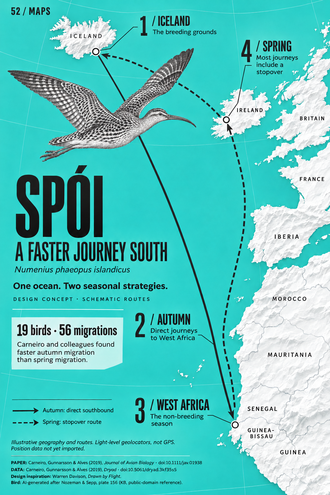

# Spói: a faster journey south

Design and story draft. No weekly slot assigned. Not published.

Poster review: this generated composition is for design discussion. Version 2 removes an incorrect south-pointing arrowhead from the dashed spring line; the solid autumn line points south, while spring arrows point north via Ireland to Iceland. Geography, relief, labels and route placement still require replacement or verification. No quantitative measurements should be taken from the image. The first concept is retained as `spoi-teal-poster.png`.

## One ocean, two seasonal strategies

For Icelandic spói, the Atlantic links breeding grounds in Iceland with non-breeding areas in West Africa. The journey changes with the season.

Carneiro and colleagues examined 56 migrations from 19 whimbrels tracked with light-level geolocators. Autumn journeys were faster and went directly to West Africa. Most spring journeys included a stopover, with Ireland among the places used. The contrast makes the return journey part of the story, rather than simply reversing the southbound line.

These are findings from the published study, not results calculated for this project. The poster currently illustrates the seasonal pattern; its routes and geography are a design concept. We have not yet imported the archived positions. Light-level geolocation carries uncertainty and should not be presented as a precise GPS flight path.

## Read the research

**Paper:** Carneiro, C., Gunnarsson, T. G. & Alves, J. A. (2019). *Faster migration in autumn than in spring: seasonal migration patterns and non-breeding distribution of Icelandic whimbrels Numenius phaeopus islandicus*. Journal of Avian Biology, 50(1). [Read the paper](https://nsojournals.onlinelibrary.wiley.com/doi/10.1111/jav.01938) · DOI: 10.1111/jav.01938.

**Data:** Carneiro, C., Gunnarsson, T. G. & Alves, J. A. (2019). *Data from: Faster migration in autumn than in spring: seasonal migration patterns and non-breeding distribution of Icelandic Whimbrels Numenius phaeopus islandicus*. Dryad. [Dataset and file list](https://datadryad.org/dataset/doi:10.5061/dryad.3kf35s5) · DOI: 10.5061/dryad.3kf35s5.

## Visual sources and generation

- Poster composition inspired by Warren Davison's [Drawn by Flight, full-size poster](https://storymaps.esri.com/stories/storyscape-resources/30-day-map-challenge/map2.png), [featured in Esri's 2025 StoryScape gallery](https://storyscape-esriwhere.hub.arcgis.com/pages/2025-30-day-map-challenge). The source poster is a visual reference; no reuse licence has been established for it. Its local reference copy is ignored by Git.
- Bird engraving: an AI-generated interpretation of a flight pose, inspired by the [public-domain Nozeman–Sepp plate](https://commons.wikimedia.org/wiki/File:Nederlandsche_vogelen_(KB)_-_Numenius_phaeopus_(304b).jpg), held by Koninklijke Bibliotheek. [Bird prompt and provenance](illustrations/README.md).
- Poster generated with OpenAI's built-in `image_gen.imagegen` tool. Exact underlying model/version is not exposed by the interface or response. [Full poster prompt](illustrations/spoi-teal-poster-prompt.txt). References: the Davison poster and the generated whimbrel engraving. Generation date: 14 November 2026.
- Version 2 used the same tool, with version 1 as its reference. [Full correction prompt](illustrations/spoi-teal-poster-v2-prompt.txt).
- The generated poster is a design artifact. Replace its geography and schematic lines with reproducible cartography before presenting a final map. Study-level counts on the poster are not position-file row counts.
