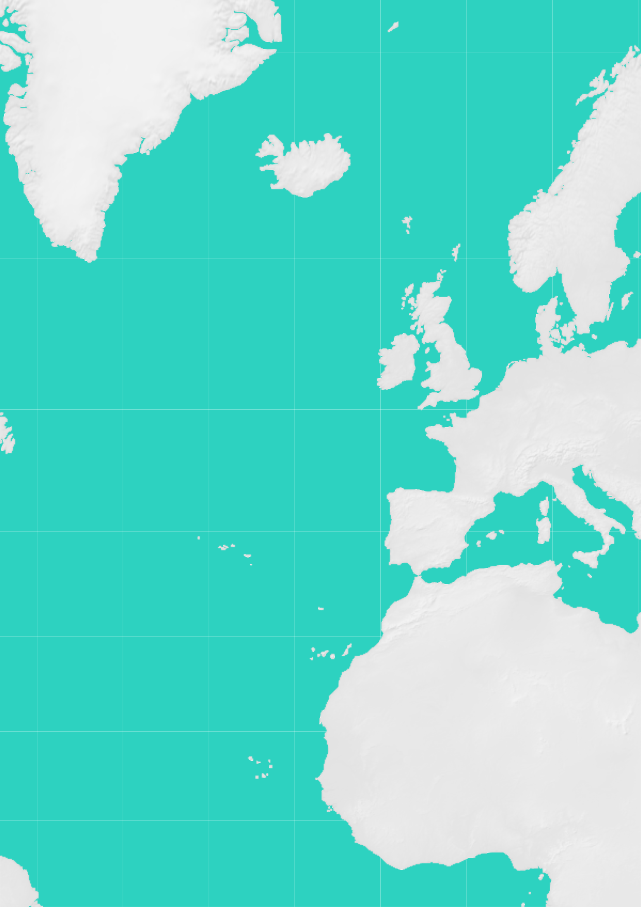
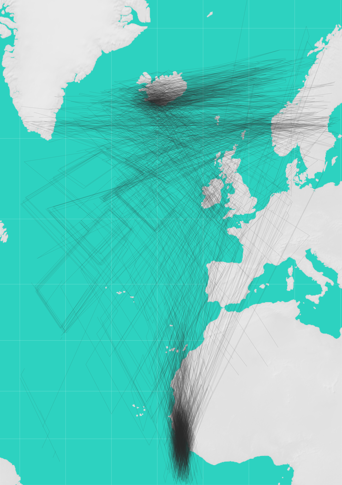
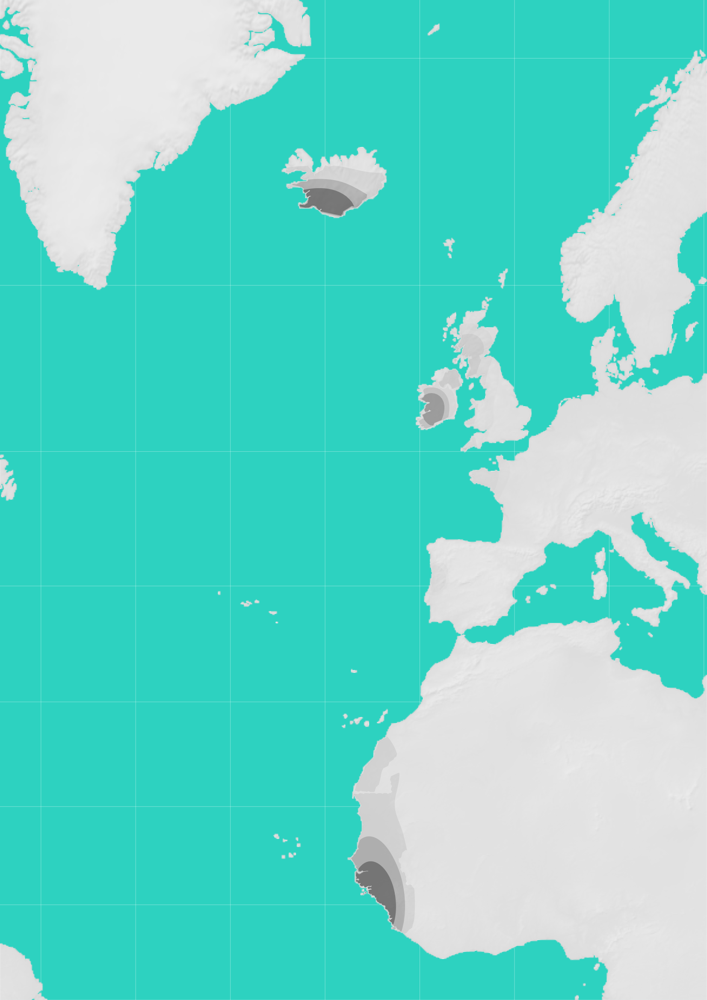
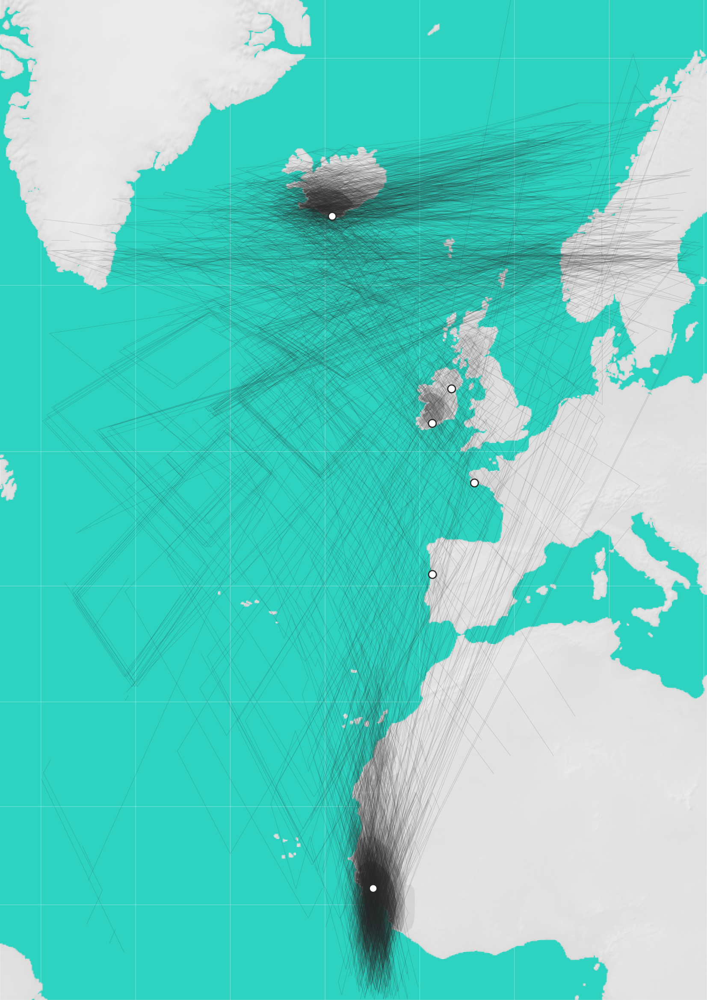
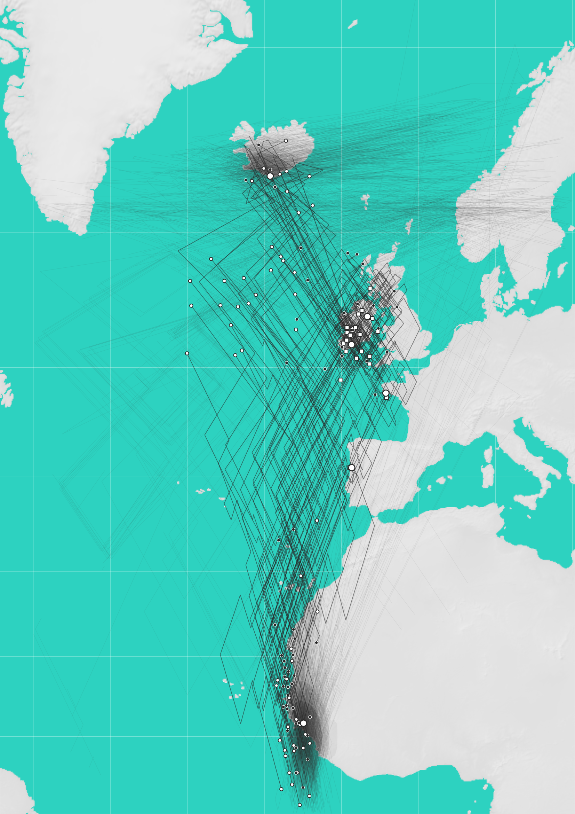
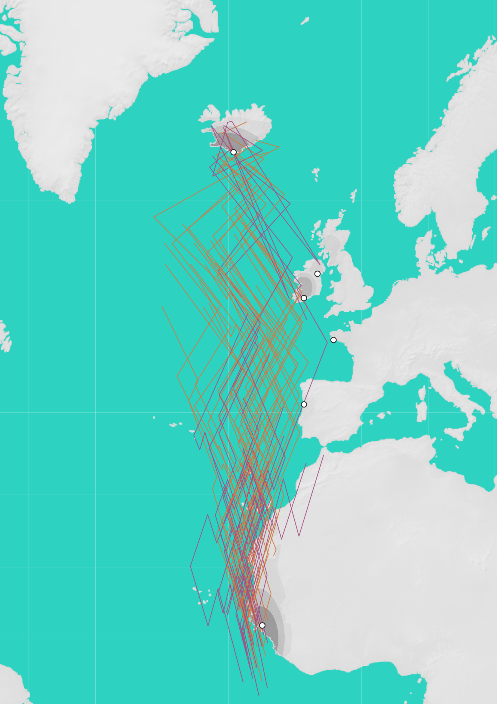
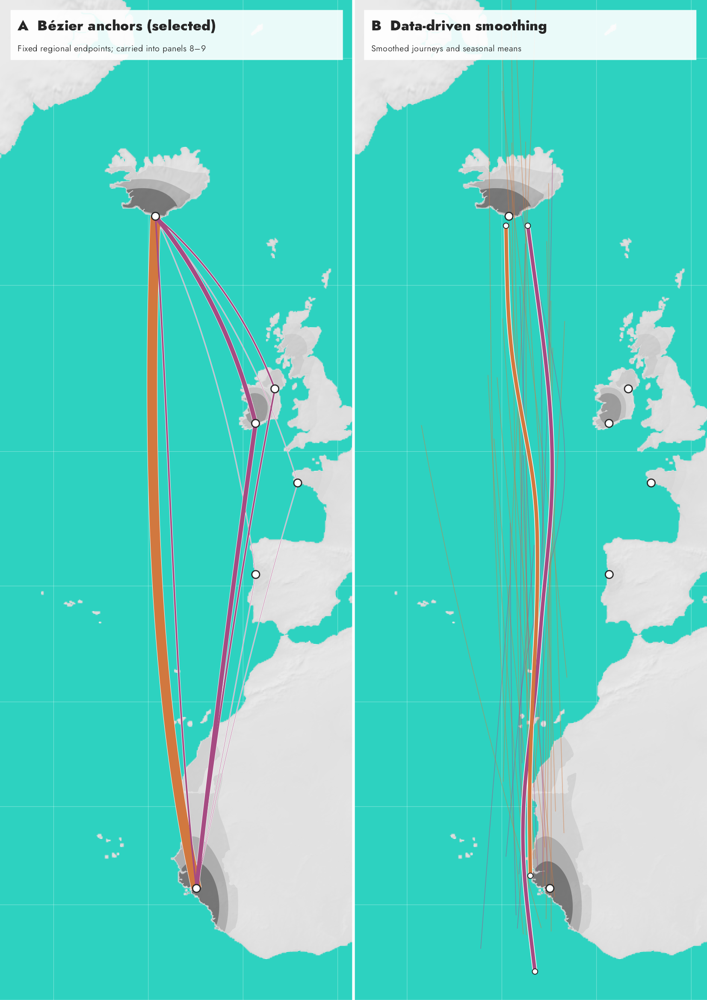
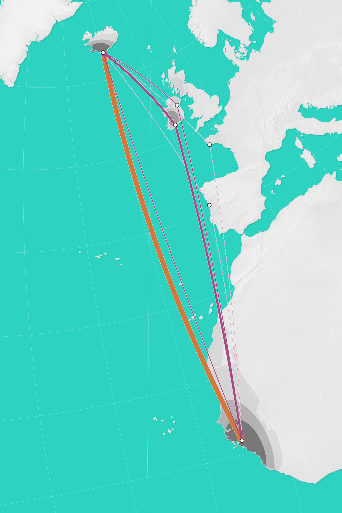

With [*Drawn by Flight*](https://storymaps.esri.com/stories/storyscape-resources/30-day-map-challenge/map2.png) by Warren Davison in mind, I set out to make a similarly story-led poster in R, using open research data about Icelandic birds. Its full-page geography, pale relief, bird illustration and numbered story notes gave me a composition to work towards. That aim led me to the Icelandic whimbrel, a bird that breeds in Iceland and spends the non-breeding season on West Africa's Atlantic coast. Carneiro, Gunnarsson and Alves followed 19 Icelandic whimbrels across 56 migrations and openly archived the tracking data on [Dryad](https://doi.org/10.5061/dryad.3kf35s5). Their [paper in the *Journal of Avian Biology*](https://doi.org/10.1111/jav.01938) is the essential companion to those files: it explains the tracking method, how the estimates were processed, and the limitations that matter when interpreting the dataset.

This page shows the resulting poster and how the data shaped its design.

## The poster

```{=html}
<figure><figcaption>Rendered in R. The curves link regions; they are not precise flight paths.</figcaption></figure>
```

[English poster](poster.png) · [Íslenskt veggspjald](poster-is.png) · A4 portrait

## Building the poster, step by step

The gallery has nine panels. It begins with the map before any tracking data, so the progression is clear: first establish the geographic canvas, then introduce the data, analyse migration behaviour, and gradually build the final infographic.

| Panels | Stage | Steps |
|:--|:--|:--|
| 1 | Geographic foundation | Start with the map |
| 2–4 | Explore the tracking data | All trajectories → Concentration regions → Anchors |
| 5–6 | Isolate seasonal migration | Temporal classification → Extract and colour journeys |
| 7 | Simplify the trajectories | Bézier anchors vs. data-driven smoothing |
| 8–9 | Compose and communicate | Oblique projection → Final illustrated map |

Seasonal colours are not introduced until panel 6, after the temporal and spatial analysis has identified the actual migration journeys. The nine panels therefore tell two connected stories: how meaningful migration journeys were extracted from tracking data, and how those journeys were turned into a readable map.

::: {layout-ncol=3}

{.lightbox group="poster-layers"}

{.lightbox group="poster-layers"}

{.lightbox group="poster-layers"}

{.lightbox group="poster-layers"}

{.lightbox group="poster-layers"}

{.lightbox group="poster-layers"}

{.lightbox group="poster-layers"}

{.lightbox group="poster-layers"}

{.lightbox group="poster-layers"}

:::

### 1. Start with the map

Establish the geographic canvas: the North Atlantic, Iceland, Western Europe and West Africa, in a north-up Mercator view with coastlines and basic geographic styling.

The base combines public-domain [Natural Earth](https://www.naturalearthdata.com/about/terms-of-use/) 1:50m land and Gray Earth shaded relief, over a teal ocean. R repairs and clips the land before projection, projects the relief with bilinear resampling and lightens it to a paper-like grey. Both source checksums and the prepared geography are retained with the analysis.

### 2. Plot all trajectories

The panel adds the complete tracking dataset for all 19 birds: migration flights, but also local movements during the breeding, non-breeding and stopover periods.

The [Dryad archive](https://doi.org/10.5061/dryad.3kf35s5) supplies two tables: twilight timestamps with derived locations, and environmental summaries. Python imports the original fields into SQLite before parsing usable values. Although named `.csv`, the source files are quoted whitespace tables.

The database retains 19,981 position rows and 67,393 environmental rows for 19 birds. A source-row key keeps derived records traceable. Missing latitude affects 657 position rows, and 57 twilight intervals run backwards. Those are this project's file audits, rather than findings quoted from the paper. Exact ages and natal sites are absent.

The display policy flags missing or invalid coordinates, reversed intervals, an approximate equinox exclusion window and estimates beyond the study-region bounds. It retains 14,074 positions. A flagged row or a gap over 36 hours breaks a line. No missing flight locations are invented. The original times and raw values remain available even when excluded from the display.

Joining the displayable estimates produces an untidy picture: repeated journeys overlap, and geolocation noise creates distracting zigzags. This panel keeps the quality-mask, annual-cycle and 36-hour breaks used for the recorded trajectories. It shows why presenting every line at equal visual weight obscures the seasonal story.

### 3. Identify concentration regions

Where do the birds spend their time? Analysing the spatial distribution of the estimates identifies the breeding, non-breeding and stopover regions.

Repeatedly tracking one bird should not give it disproportionate influence over a regional anchor. The calculation summarises repeated cycles within each bird, then weights birds equally in projected coordinates.

The shaded regions use weighted Gaussian kernels with fixed, illustrative bandwidths: 90 km for Iceland and stopovers, 160 km for the non-breeding region. The 50%, 75% and 95% concentration regions are conditioned on land. Darkness also reflects the number of contributing birds. These regions describe concentration under this display method; they are not location-error confidence bounds, a global species range or a reproduction of the paper's kernel analysis.

### 4. Add the geographic anchors

Overlaying the concentration regions on the original trajectories shows how the untidy lines gather into a few places. Each region gets one anchor point, and these anchors are the geographic reference for the analysis and simplification that follow.

Light-derived coordinates are noisy. The original Iceland regional mean falls offshore. For the schematic map, R moves that display anchor to the nearest point within the intended land region, using a 1 km inset where possible. The movement is about **157 km**. Both the unconstrained mean and the displacement remain in SQLite; the raw observations are not snapped to land. That substantial adjustment is a reason to label the map as a regional summary.

### 5. Identify seasonal migration events

The timestamps and concentration regions together determine when each bird leaves its breeding or non-breeding grounds and begins its seasonal migration. This separates migration from local activity, while allowing for stopovers along the way. The panel highlights the 56 complete candidate journeys in dark grey: open circles mark the first estimate of each journey, filled circles the last, and squares the 21 candidate stops. Everything else fades.

Candidate stops require sustained spatial stability and supporting sensor coverage. Country labels use a nearest-country rule with offshore uncertainty checks. Local changes in temperature, wet-contact and conductivity summaries refine candidate arrival and departure times. These heuristics do not reproduce the authors' full manually checked processing.

### 6. Extract and colour migration journeys

Only the relevant portions of the trajectories are kept. Estimates outside the journey intervals, and local movements during extended stopovers, are removed. The remaining southbound autumn migrations are coloured orange, and northbound spring migrations magenta.

The paper's seasonal contrast motivates the two colours; it does not supply these per-position labels. Removing a stopover breaks the line rather than bridging the gap, and quality-mask, cycle and 36-hour breaks still apply. Geolocation noise remains visible in the zigzags: these are the extracted estimates, not yet a simplified route.

### 7. Smooth the migration routes

The extracted journeys are still too noisy to read. Panel 7 compares two ways of simplifying them, side by side.

**A) Bézier curves connecting the concentration-region anchors.** The orange and magenta curves are cubic Bézier links. Given endpoints A and B, R creates two control points by moving one-third and two-thirds along the segment and adding a perpendicular offset. The curve is:

`C(t) = (1-t)^3 A + 3(1-t)^2 t P1 + 3(1-t) t^2 P2 + t^3 B`, for `0 <= t <= 1`.

```r
delta <- B - A
normal <- c(-delta[2], delta[1])
offset <- normal / sqrt(sum(normal^2)) * bend
P1 <- A + delta / 3 + offset
P2 <- A + 2 * delta / 3 + offset
```

The endpoints stay fixed at the regional anchors. An Ireland route joins an Africa-to-Ireland curve to an Ireland-to-Iceland curve, meeting exactly at the Ireland anchor. The join is continuous in position; it is not guaranteed to have a continuous tangent. Bend values are design choices for readable separation, rather than estimates of where birds flew.

Line width uses one count scale, 0.13 mm per journey in the static export. The southbound band represents the paper's 30 direct autumn migrations. Spring lanes use this project's exploratory classifications: 13 via Ireland, five via the United Kingdom, five direct, one via France and one via Portugal. One unresolved country is retained in the denominator of 26 but has no invented mapped lane. The two sources of counts are deliberately documented separately.

**B) Data-driven smoothing of the extracted migration trajectories.** Each extracted journey with at least eight travelling estimates is smoothed with a cubic smoothing spline (`spar = 0.8`) of longitude and latitude against time; these are the thin lines. For the seasonal means, the extracted estimates are grouped into 2-degree latitude bins. The calculation takes the median longitude for each journey, averages journeys within each bird, and then weights birds equally. Bins need at least three contributing birds, and a weighted smoothing spline (`spar = 0.65`) softens the result. The bin means are saved in `breakdown-smoothing.csv`.

Approach B stays closer to the data, but the seasonal means end wherever the bin support runs out. The spring mean begins near 3°N, well south of the non-breeding anchor, and both means finish offshore south of Iceland. Averaging also merges the direct and Ireland spring routes into a single line, hiding the stopover contrast the poster is about. Approach A keeps meaningful endpoints and separate spring lanes, so it is carried forward into panels 8 and 9.

### 8. Tilt the composition

The view switches to an oblique Mercator projection, orienting the map around the North Atlantic migration corridor while preserving the underlying geographic relationships.

An oblique Mercator projection, tilted 15 degrees, places Iceland and West Africa along the poster's diagonal. This is a cartographic composition, not a geographical rearrangement: every geographic layer uses the same transform.

```r
projection <- paste(
  "+proj=omerc +lat_0=35 +lonc=-20 +alpha=15",
  "+gamma=0 +k=1 +datum=WGS84 +units=m +no_defs"
)
```

The scale bar describes an approximate 1,000 km distance at its own location. Projection scale varies across the map. Schematic route curves cannot be used to measure flight distances.

With the journey structure established, the diagonal composition creates a useful ocean text area. Choosing the final view here in the design walkthrough makes that purpose visible. It does not mean rotating a finished screenshot: land, relief, regions and route geometry all share the final projected coordinates.

### 9. Tell the story

The whimbrel illustration, numbered stages, explanatory annotations, labels, legend, scale and data sources complete the infographic.

The public text rounds those estimates: about 4–5 days south; about 12 days stopped in Ireland; about 16 days for the whole spring journey via Ireland, versus about five direct. Only accepted timing estimates contribute to the relevant averages. A stop is detected behaviour; its purpose is not measured. The suggestion of building reserves or awaiting favourable conditions remains an explanation proposed by the study's authors.

Complete paired stays suggest about three months on Iceland's breeding grounds and eight months in West Africa. The summer estimate uses only eight paired stays from four birds; the winter estimate uses 24 stays from 17 birds. These separate subsets are not a complete twelve-month budget for a representative individual.

The layout, labels, relief and map geometry are made in R with `ggplot2`, `sf`, `terra`, `grid` and `ragg`. Jost is bundled under its OFL licence. English and Icelandic exports share the same layout; text widths are measured to keep the common name and subtitle balanced.

The ornamental bird is an AI-generated flight interpretation inspired by the [public-domain Nozeman–Sepp reference](https://commons.wikimedia.org/wiki/File:Nederlandsche_vogelen_(KB)_-_Numenius_phaeopus_(304b).jpg), from Koninklijke Bibliotheek. It is not an authentic historical flight drawing or a validated identification plate. OpenAI's `image_gen.imagegen` created it on 14 November 2026; the exact model identifier was not exposed. The [illustration folder](https://github.com/tungufoss/maps/tree/feature/iceland-bird-migration/research/illustrations) records the used prompt, references and reuse notes.

Warren Davison's [Drawn by Flight](https://storymaps.esri.com/stories/storyscape-resources/30-day-map-challenge/map2.png), featured in Esri's 2025 collection, inspired the narrative-poster approach. His artwork is not incorporated into this poster. [Cephas's whimbrel distribution map](https://commons.wikimedia.org/wiki/File:Numenius_phaeopus_distribution_map.svg) inspired the distinction between seasonal roles; its image and range polygons are not copied.

## Reproduce it

The committed [SQLite database](https://github.com/tungufoss/maps/blob/feature/iceland-bird-migration/data/spoi/spoi.sqlite) contains the imported observations, quality flags, derived analysis and cached cartography. The website serves prepared outputs; visitors need no R or database server.

```sh
# From the repository root, with dependencies in research/spoi/README.md installed:
Rscript research/spoi/build.R
# Fast text/layout changes from cached analysis:
Rscript research/spoi/render-prepared.R
```

To rebuild the raw import, obtain the original Dryad files and run `python scripts/build_spoi_db.py` before the R build. The [full reproducibility guide](https://github.com/tungufoss/maps/blob/feature/iceland-bird-migration/research/spoi/README.md) records quality rules, projection, dependencies and limitations. Recorded versions include R 4.5.3, `sf` 1.1.0, `ggplot2` 4.0.2, `leaflet` 2.2.3 and `ragg` 1.5.1.

## References

Carneiro, C., Gunnarsson, T. G. & Alves, J. A. (2019). *Faster migration in autumn than in spring: seasonal migration patterns and non-breeding distribution of Icelandic whimbrels Numenius phaeopus islandicus*. Journal of Avian Biology 50(1). [Paper](https://doi.org/10.1111/jav.01938).

Same authors (2019), corresponding dataset. Dryad, CC0-1.0. [Data and usage notes](https://doi.org/10.5061/dryad.3kf35s5).
