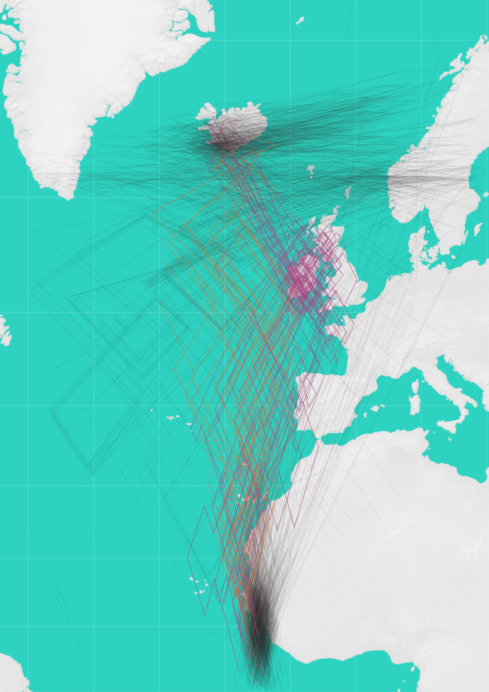
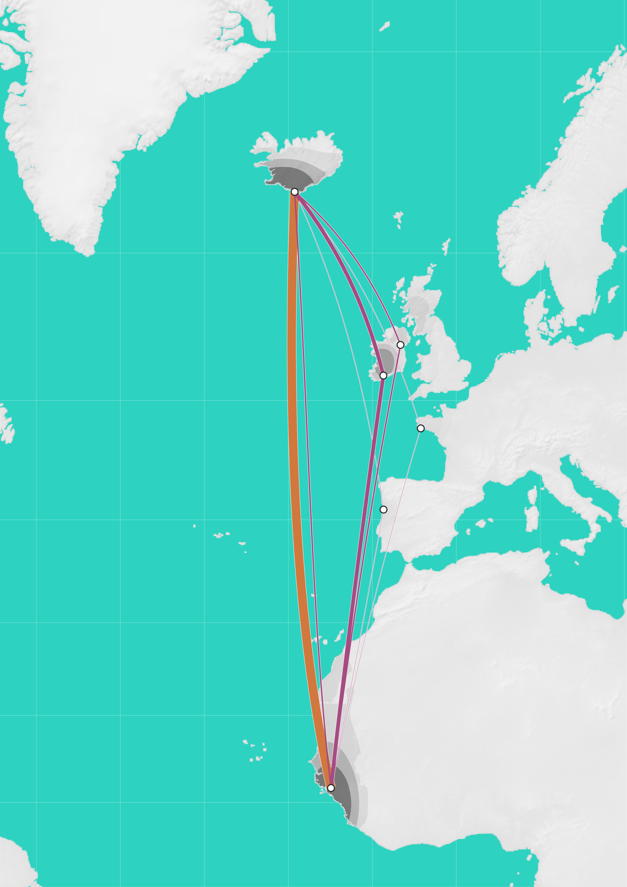
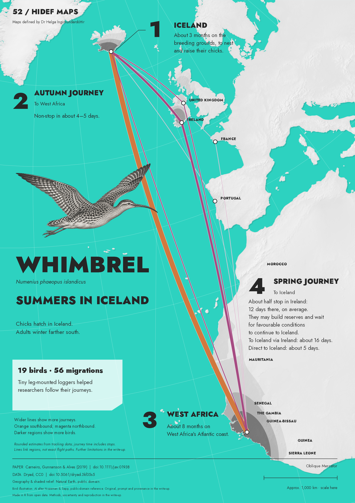

Warren Davison's [Drawn by Flight](https://storymaps.esri.com/stories/storyscape-resources/30-day-map-challenge/map2.png) was the starting point: could I make a similarly story-led poster in R, using open research data about Icelandic birds? Its full-page geography, pale relief, bird illustration and numbered story notes gave me a composition to work towards.

That question led to the Icelandic whimbrel: a bird that breeds in Iceland and spends the non-breeding season on West Africa's Atlantic coast.

The dataset comes from [Carneiro, Gunnarsson and Alves's study](https://doi.org/10.1111/jav.01938) and is openly archived on [Dryad](https://doi.org/10.5061/dryad.3kf35s5). The study followed 19 Icelandic whimbrels across 56 migrations. The openly accessible paper is an essential companion to the files: it explains the tracking method, how the estimates were processed, and the limitations that matter when interpreting the dataset.

This page shows the resulting poster and how those observations shaped its design.

## The poster

```{=html}
<figure><figcaption>Rendered in R. The curves link regions; they are not precise flight paths.</figcaption></figure>
```

[English poster](poster.png) · [Íslenskt veggspjald](poster-is.png) · A4 portrait

## Building the poster, step by step

With [*Drawn by Flight*](https://storymaps.esri.com/stories/storyscape-resources/30-day-map-challenge/map2.png) by Warren Davison in mind, I started by putting all the recorded trajectories on a map. The design emerged by simplifying that untidy picture, giving the routes meaningful endpoints, and then choosing a composition that left room for the story.

The gallery follows those design decisions. Its first six panels use a north-up Mercator view; the seventh changes to the final oblique view, and the eighth adds text and illustration. The production renderer applies the selected projection consistently to every geographic layer before placing the final annotations.

::: {layout-ncol=3}

{.lightbox group="poster-layers"}

{.lightbox group="poster-layers"}

{.lightbox group="poster-layers"}

{.lightbox group="poster-layers"}

{.lightbox group="poster-layers"}

{.lightbox group="poster-layers"}

{.lightbox group="poster-layers"}

{.lightbox group="poster-layers"}

:::

Click a thumbnail to open the gallery. Use Next/Previous or the left/right arrow keys to compare stages; Escape closes it.

### 1. Start with the map

The base combines public-domain [Natural Earth](https://www.naturalearthdata.com/about/terms-of-use/) 1:50m land and Gray Earth shaded relief, over a teal ocean. R repairs and clips the land before projection, projects the relief with bilinear resampling and lightens it to a paper-like grey. Both source checksums and the prepared geography are retained with the analysis.

### 2. Put all the trajectories on it

The [Dryad archive](https://doi.org/10.5061/dryad.3kf35s5) supplies two tables: twilight timestamps with derived locations, and environmental summaries. Python imports the original fields into SQLite before parsing usable values. Although named `.csv`, the source files are quoted whitespace tables.

The database retains 19,981 position rows and 67,393 environmental rows for 19 birds. A source-row key keeps derived records traceable. Missing latitude affects 657 position rows, and 57 twilight intervals run backwards. Those are this project's file audits, rather than findings quoted from the paper. Exact ages and natal sites are absent.

The display policy flags missing or invalid coordinates, reversed intervals, an approximate equinox exclusion window and estimates beyond the study-region bounds. It retains 14,074 positions. A flagged row or a gap over 36 hours breaks a line. No missing flight locations are invented. The original times and raw values remain available even when excluded from the display.

Joining the displayable estimates produces an untidy picture: repeated journeys overlap, and geolocation noise creates distracting zigzags. This panel keeps the quality-mask, annual-cycle and 36-hour breaks used for the recorded trajectories. It shows why presenting every line at equal visual weight obscures the seasonal story.

### 3. Colour the seasonal journeys

The paper's seasonal contrast suggested the next visual decision: orange for southbound autumn journeys, magenta for northbound spring journeys. Colour makes the two directions easier to follow in the overlapping estimates, before simplifying their shapes.

For this panel, recorded positions inherit a direction only when they fall within a complete candidate journey identified by this project's event analysis. Positions outside those intervals stay faint grey, and colour changes do not bridge gaps. The paper motivates the distinction; it does not supply these per-position labels.

### 4. Smooth the pattern—and inspect where it ends

An earlier candidate summary grouped positions into 2.5-degree latitude bins. Within each bin, it took the median longitude for each bird/cycle, averaged cycles within birds, and then gave birds equal weight. Bins needed at least five contributing birds. A cubic smoothing spline (`spar = 0.65`) softened the supported bin means.

The next panel uses the same seasonal colours for the archived candidate curves. That earlier smoothing used the July–September and April–May calendar windows, rather than the candidate-event labels in the preceding panel. Their endpoints follow the available latitude-bin support, leaving the northern ends offshore, east of Iceland, and the southern ends beyond the intended non-breeding region. A smoother line alone does not establish a meaningful departure or arrival location. Calendar-window aggregation can also mix stationary and migrating estimates.

This became a design turning point: identify the regions and candidate journeys, then construct the final links between their anchors. The archived smooths remain in SQLite and CSV for audit; they are not the final poster's routes.

### 5. Fix the source, sink and waypoints

Repeatedly tracking one bird should not give it disproportionate influence over a regional anchor. The calculation summarises repeated cycles within each bird, then weights birds equally in projected coordinates.

Light-derived coordinates are noisy. The original Iceland regional mean falls offshore. For the schematic map, R moves that display anchor to the nearest point within the intended land region, using a 1 km inset where possible. The movement is about **157 km**. Both the unconstrained mean and the displacement remain in SQLite; the raw observations are not snapped to land. That substantial adjustment is a reason to label the map as a regional summary.

#### Connect the anchors

The orange and magenta curves are cubic Bézier links. Given endpoints A and B, R creates two control points by moving one-third and two-thirds along the segment and adding a perpendicular offset. The curve is:

`C(t) = (1-t)^3 A + 3(1-t)^2 t P1 + 3(1-t) t^2 P2 + t^3 B`, for `0 <= t <= 1`.

```r
delta <- B - A
normal <- c(-delta[2], delta[1])
offset <- normal / sqrt(sum(normal^2)) * bend
P1 <- A + delta / 3 + offset
P2 <- A + 2 * delta / 3 + offset
```

The endpoints stay fixed at the regional anchors. An Ireland route joins an Africa-to-Ireland curve to an Ireland-to-Iceland curve, meeting exactly at the Ireland anchor. The join is continuous in position; it is not guaranteed to have a continuous tangent. Bend values are design choices for readable separation, rather than estimates of where birds flew.

Line width uses one count scale, 0.13 mm per journey in the static export. The southbound band represents the paper's 30 direct autumn migrations. Spring lanes use this project's exploratory classifications: 13 via Ireland, five via the United Kingdom, five direct, one via France and one via Portugal. One unresolved country is retained in the denominator of 26 but has no invented mapped lane. The two sources of counts are deliberately documented separately.

Candidate stops require sustained spatial stability and supporting sensor coverage. Country labels use a nearest-country rule with offshore uncertainty checks. Local changes in temperature, wet-contact and conductivity summaries refine candidate arrival and departure times. These heuristics do not reproduce the authors' full manually checked processing.

### 6. Add the concentration regions

The shaded regions use weighted Gaussian kernels with fixed, illustrative bandwidths: 90 km for Iceland and stopovers, 160 km for the non-breeding region. The 50%, 75% and 95% concentration regions are conditioned on land. Darkness also reflects the number of contributing birds. These regions describe concentration under this display method; they are not location-error confidence bounds, a global species range or a reproduction of the paper's kernel analysis.

The previous panel shows the anchored connections alone. This step adds the concentration layer beneath those same routes, keeping location concentration and journey counts as separate visual encodings.

### 7. Tilt the composition

An oblique Mercator projection, tilted 15 degrees, places Iceland and West Africa along the poster's diagonal. This is a cartographic composition, not a geographical rearrangement: every geographic layer uses the same transform.

```r
projection <- paste(
  "+proj=omerc +lat_0=35 +lonc=-20 +alpha=15",
  "+gamma=0 +k=1 +datum=WGS84 +units=m +no_defs"
)
```

The scale bar describes an approximate 1,000 km distance at its own location. Projection scale varies across the map. Schematic route curves cannot be used to measure flight distances.

With the journey structure established, the diagonal composition creates a useful ocean text area. Choosing the final view here in the design walkthrough makes that purpose visible. It does not mean rotating a finished screenshot: land, relief, regions and route geometry all share the final projected coordinates.

### 8. Add the story, illustration and typography

The public text rounds those estimates: about 4–5 days south; about 12 days stopped in Ireland; about 16 days for the whole spring journey via Ireland, versus about five direct. Only accepted timing estimates contribute to the relevant averages. A stop is detected behaviour; its purpose is not measured. The suggestion of building reserves or awaiting favourable conditions remains an explanation proposed by the study's authors.

Complete paired stays suggest about three months on Iceland's breeding grounds and eight months in West Africa. The summer estimate uses only eight paired stays from four birds; the winter estimate uses 24 stays from 17 birds. These separate subsets are not a complete twelve-month budget for a representative individual.

The layout, labels, relief and map geometry are made in R with `ggplot2`, `sf`, `terra`, `grid` and `ragg`. Jost is bundled under its OFL licence. English and Icelandic exports share the same layout; text widths are measured to keep the common name and subtitle balanced.

The ornamental bird is an AI-generated flight interpretation inspired by the [public-domain Nozeman–Sepp reference](https://commons.wikimedia.org/wiki/File:Nederlandsche_vogelen_(KB)_-_Numenius_phaeopus_(304b).jpg), from Koninklijke Bibliotheek. It is not an authentic historical flight drawing or a validated identification plate. OpenAI's `image_gen.imagegen` created it on 14 November 2026; the exact model identifier was not exposed. The [illustration folder](https://github.com/tungufoss/maps/tree/feature/iceland-bird-migration/research/illustrations) records the used prompt, references and reuse notes.

Warren Davison's [Drawn by Flight](https://storymaps.esri.com/stories/storyscape-resources/30-day-map-challenge/map2.png), featured in Esri's 2025 collection, inspired the narrative-poster approach. His artwork is not incorporated into this poster. [Cephas's whimbrel distribution map](https://commons.wikimedia.org/wiki/File:Numenius_phaeopus_distribution_map.svg) inspired the distinction between seasonal roles; its image and range polygons are not copied.

## Reproduce it

The committed [SQLite database](https://github.com/tungufoss/maps/blob/feature/iceland-bird-migration/data/spoi/spoi.sqlite) contains the imported observations, quality flags, derived analysis and cached cartography. The website serves prepared outputs; visitors need no R or database server.

```sh
# From the repository root, with dependencies in research/spoi/README.md installed:
Rscript research/spoi/build.R
# Fast text/layout changes from cached analysis:
Rscript research/spoi/render-prepared.R
```

To rebuild the raw import, obtain the original Dryad files and run `python scripts/build_spoi_db.py` before the R build. The [full reproducibility guide](https://github.com/tungufoss/maps/blob/feature/iceland-bird-migration/research/spoi/README.md) records quality rules, projection, dependencies and limitations. Recorded versions include R 4.5.3, `sf` 1.1.0, `ggplot2` 4.0.2, `leaflet` 2.2.3 and `ragg` 1.5.1.

## References

Carneiro, C., Gunnarsson, T. G. & Alves, J. A. (2019). *Faster migration in autumn than in spring: seasonal migration patterns and non-breeding distribution of Icelandic whimbrels Numenius phaeopus islandicus*. Journal of Avian Biology 50(1). [Paper](https://doi.org/10.1111/jav.01938).

Same authors (2019), corresponding dataset. Dryad, CC0-1.0. [Data and usage notes](https://doi.org/10.5061/dryad.3kf35s5).
